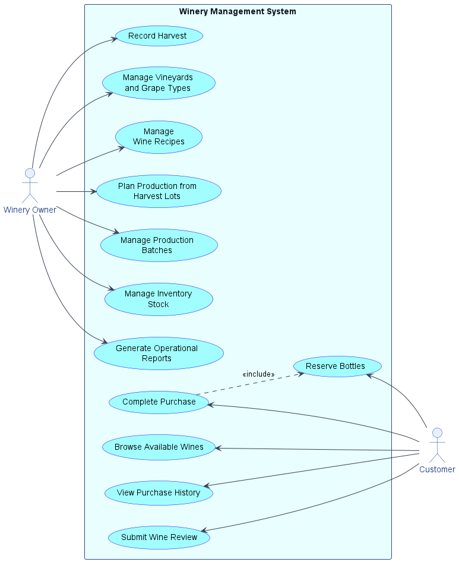
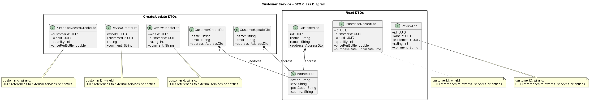
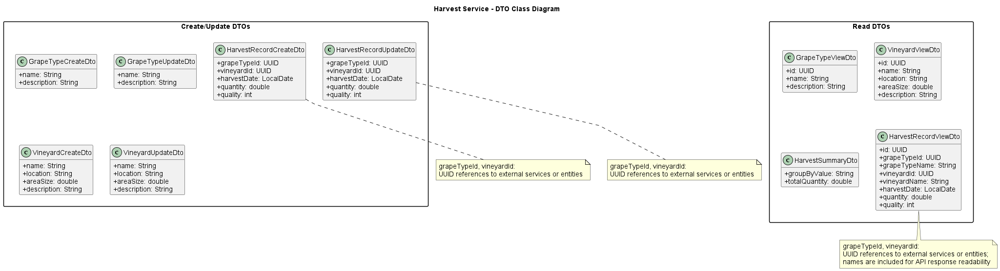
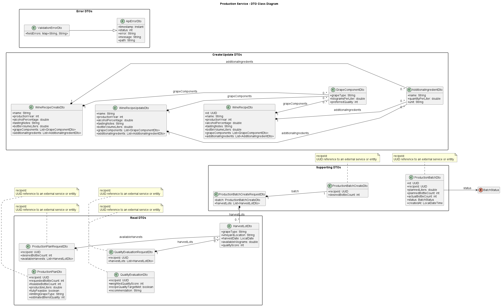
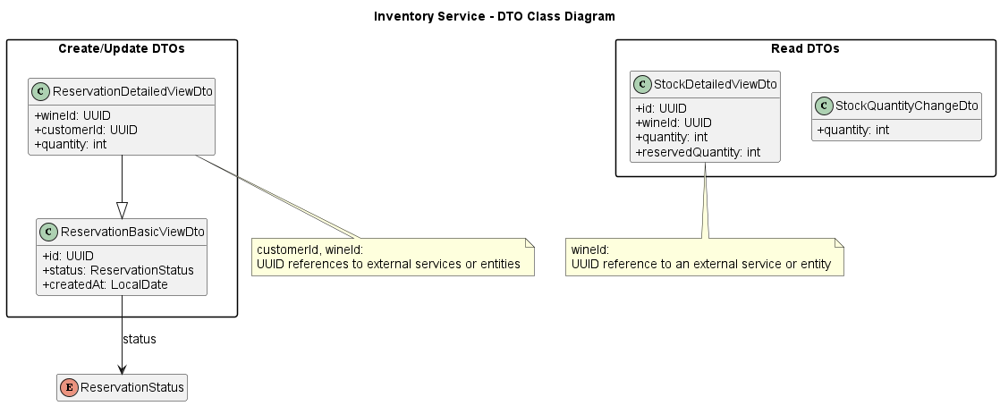

# Winery Management System

## Project Description

Winery Management System is a microservice-based Spring Boot application for winery operations management.
The goal is to support the complete flow from grape harvest to wine production, inventory handling, and customer sales.

The system covers:

- yearly harvest evidence (grape type, vineyard, date, quantity, quality),
- wine recipe and production planning,
- bottle inventory and reservation management,
- customer profiles, purchases, and wine reviews.

The system is split into 5 executable Maven modules:

1. `common-service`
   Handles shared application concerns:

- shared exceptions and error handling,
- reusable API/common classes,
- code extracted from multiple services during refactoring.

2. `customer-service`
   Handles customer-related operations:

- customer profile management,
- purchase history,
- wine reviews and feedback.

3. `harvest-service`
   Handles harvest domain:

- vineyards and grape types management,
- harvest records,
- harvest summaries.

4. `production-service`
   Handles production domain:

- wine recipe management,
- production planning from available harvest lots,
- blend quality evaluation,
- production batch lifecycle.

5. `inventory-service`
   Handles stock domain:

- bottle stock tracking,
- reservation tracking,
- available/reserved quantity changes.

## Non-trivial Business Functionalities

Implemented business functionality beyond CRUD:

1. `customer-service`

- purchase history filtering by quantity interval (`min`/`max`) with input normalization,
- total spending computation per customer (sum of quantity x price per bottle),
- customer/wine based review and purchase history retrieval workflows.

2. `harvest-service`

- harvest quantity aggregation by year (`summary/by-year`),
- harvest quantity aggregation by vineyard (`summary/by-vineyard`),
- domain validation linking harvest records to existing vineyard and grape type entities.

3. `production-service`

- production feasibility planning from recipe composition and available harvest lots (requested vs feasible bottle
  count, producible liters, limiting grape type),
- weighted blend quality evaluation with recommendation output based on quality target,
- creation of planned production batches from computed production plan.

4. `inventory-service`

- stock removal guarded by available (non-reserved) quantity checks,
- reservation status transitions with stock/reserved quantity adjustments,
- stock lookup by wine and reservation filtering by customer/wine/date interval.

## Executable Modules

Executable Spring Boot modules:

- `common-service`
- `customer-service`
- `harvest-service`
- `production-service`
- `inventory-service`

## Technology Stack

The project is built with:

- Java
- Spring Boot
- Maven
- MapStruct
- springdoc-openapi
- Spring Data JPA
- H2 in-memory database
- Apache ActiveMQ Artemis (JMS)
- Docker

## Build And Run

For Milestone 2, the project gradually connects the REST API to the service and persistence layers.
Services use Spring Data JPA with an H2 in-memory database.

Build whole project:

```bash
mvn clean install
```

Run production-service tests with its local module dependencies:

```bash
mvn -pl production-service -am test
```

Run one service module (example):

```bash
mvn -pl harvest-service spring-boot:run
```

You can run other modules analogically:

```bash
mvn -pl common-service spring-boot:run
mvn -pl customer-service spring-boot:run
mvn -pl production-service spring-boot:run
mvn -pl inventory-service spring-boot:run
```

Alternatively, you can enter a concrete service module directory and run:

```bash
mvn spring-boot:run
```

## Docker

Build and run services with Docker Compose:

```bash
docker compose up --build
```

Rebuild from scratch without cache (recommended after messaging changes):

```bash
docker compose build --no-cache
docker compose up
```

Stop Docker Compose services:

```bash
docker compose down
```

### Artemis Broker

Docker Compose includes an Apache ActiveMQ Artemis broker used for asynchronous communication.

- Broker TCP endpoint: `localhost:61616`
- Artemis web console: [http://localhost:8161](http://localhost:8161)
- Default credentials: `artemis` / `artemis`

### Harvest-service

Build the harvest-service Docker image:

```bash
docker build -f harvest-service/Dockerfile -t winery-management/harvest-service:latest .
```

Run the harvest-service container:

```bash
docker run --rm -p 8081:8081 winery-management/harvest-service:latest
```

### Inventory-service

Build the inventory-service Docker image:

```bash
docker build -t inventory-service -f .\inventory-service\Dockerfile .
```

Run the inventory-service container:

```bash
docker run -d --name winery-inventory -p 8083:8083 inventory-service
```

### Production-service

Build the production-service Docker image:

```bash
docker build -f production-service/Dockerfile -t winery-management/production-service:latest .
```

Run the production-service container:

```bash
docker run --rm -p 8082:8082 winery-management/production-service:latest
```

### Customer-service

Build the customer-service Docker image:

```bash
docker build -f customer-service/Dockerfile -t winery-management/customer-service:latest .
```

Run the customer-service container:

```bash
docker run --rm -p 8084:8084 winery-management/customer-service:latest
```

## Asynchronous Communication (M2)

Implemented message flow:

- `production-service` (producer) sends `BatchCompletedMessage` to queue `batch-completed-queue`
- `inventory-service` (consumer) reads message asynchronously, stores inbound log, and updates stock
- `inventory-service` sends `StockUpdatedMessage` to `stock-updated-queue` (optional feedback event)

Queue names are centralized in `common-service`:

- `batch-completed-queue`
- `stock-updated-queue`

Message persistence:

- Producer outbound log table: `OUTBOUND_MESSAGE_LOG` (`production-service` DB)
- Consumer inbound log table: `INBOUND_MESSAGE_LOG` (`inventory-service` DB)

How to verify messaging end-to-end:

1. Start stack with Docker Compose (`docker compose up --build`).
2. Create/update a production batch and set status to `COMPLETED` in production-service API.
3. Check Artemis console queue metrics (message count/delivering count).
4. Check DB logs in both services (`OUTBOUND_MESSAGE_LOG`, `INBOUND_MESSAGE_LOG`).

## CI Pipeline

The project includes a GitLab CI pipeline configured in [`.gitlab-ci.yml`](.gitlab-ci.yml).

The pipeline is executed for:

- pushes to the `main` branch,
- merge requests.

The pipeline uses the Maven image `maven:3.9.12-eclipse-temurin-25` for Java/Maven jobs and caches the local
Maven repository in `.m2/repository` to speed up repeated builds.

Pipeline stages:

1. `test`
   Runs Maven tests for each executable service module:

- `customer-service`
- `harvest-service`
- `inventory-service`
- `production-service`

Each test job uses:

```bash
mvn -pl "${SERVICE_NAME}" -am test
```

The `-am` flag also builds required dependent modules, for example `common-service`, so every service is tested
with the modules it needs.

2. `build`
   Verifies that every executable service can be built as a Maven module:

```bash
mvn -pl "${SERVICE_NAME}" -am -DskipTests -Dmaven.test.skip=true clean install
```

Tests are intentionally skipped in this stage because they already run in the previous `test` stage. This stage
checks packaging and module build correctness.

3. `docker_build`
   Verifies Docker image builds for all executable services:

- `customer-service/Dockerfile`
- `harvest-service/Dockerfile`
- `inventory-service/Dockerfile`
- `production-service/Dockerfile`

Docker builds are performed with Kaniko using `--no-push`, so CI validates the Dockerfiles without publishing
images to a container registry.

4. `docker_publish`
   Publishes Docker images for all executable services to Quay on pushes to the `main` branch:

- `quay.io/${QUAY_NAMESPACE}/customer-service:${CI_COMMIT_SHORT_SHA}`
- `quay.io/${QUAY_NAMESPACE}/harvest-service:${CI_COMMIT_SHORT_SHA}`
- `quay.io/${QUAY_NAMESPACE}/inventory-service:${CI_COMMIT_SHORT_SHA}`
- `quay.io/${QUAY_NAMESPACE}/production-service:${CI_COMMIT_SHORT_SHA}`

Each image is also tagged as `latest`. The publish jobs use the GitLab CI/CD variables `QUAY_NAMESPACE`,
`QUAY_USERNAME`, and `QUAY_PASSWORD`.

In short, the CI pipeline checks that every service:

- passes its Maven tests,
- can be built together with required module dependencies,
- has a Dockerfile that can be built successfully,
- is published to Quay from `main`.

Container runtime validation with Docker Compose is currently intended to be performed locally, because the
current GitLab runner setup does not provide a working Docker daemon for `docker compose up` / `docker run`
checks inside CI jobs.

Recommended local Docker verification commands:

```bash
docker compose up --build artemis production-service inventory-service
docker compose down
```

## Security (M3)

The `harvest-service` is configured as an OAuth 2 Resource Server based on the PA165 seminar security setup.
It validates MUNI-issued JWT access tokens from `https://id.muni.cz/oidc/`.

Harvest API authorization rules:

- `GET /vineyards/**`, `GET /grape-types/**`, and `GET /harvest-records/**` require scope `test_read`.
- `POST`, `PUT`, and `DELETE` operations on harvest endpoints require scope `test_write`.
- Swagger UI and OpenAPI docs remain publicly accessible so that an access token can be provided through Swagger UI.

Swagger OAuth configuration for `harvest-service` requests the following scopes:

- `openid`
- `test_read`
- `test_write`

## Kubernetes / OpenShift Deployment

The project contains an OpenShift template in [
`openshift/winery-stack-template.yaml`](openshift/winery-stack-template.yaml).
It deploys:

- Apache ActiveMQ Artemis as an internal broker,
- `customer-service`,
- `harvest-service`,
- `inventory-service`,
- `production-service`.

All API services get OpenShift `Route` objects so they can be tested from outside the cluster. Artemis is exposed only
inside the OpenShift project and is used by `production-service` and `inventory-service` through
`tcp://artemis:61616`.

### Quay Setup

Create or use an existing Quay namespace, for example your faculty login. In that namespace, create these public
repositories:

- `customer-service`
- `harvest-service`
- `inventory-service`
- `production-service`

Create a Quay robot account or token with write access to these repositories.

In GitLab, configure these project CI/CD variables:

- `QUAY_NAMESPACE`: your Quay namespace, for example `xlogin`
- `QUAY_USERNAME`: Quay username or robot account name
- `QUAY_PASSWORD`: Quay password or robot token

Mark `QUAY_USERNAME` and `QUAY_PASSWORD` as masked. If the `main` branch is protected, mark the variables as protected
too.

After merging to `main`, wait for the `docker_publish` jobs to finish. They publish each service image with both the
commit tag and the `latest` tag.

### OpenShift Setup

Create or open your Red Hat Developer Sandbox and log in with the `oc` CLI. In the OpenShift console, use
`Copy login command`, then run the copied command locally:

```bash
oc login --token=<your-token> --server=<your-openshift-api-url>
```

Deploy the full stack from the repository root:

```bash
oc process -f openshift/winery-stack-template.yaml \
  -p QUAY_NAMESPACE=<your-quay-namespace> \
  -p IMAGE_TAG=latest \
  | oc apply -f -
```

To deploy a specific Git commit image instead of `latest`, use the commit short SHA from the successful GitLab pipeline:

```bash
oc process -f openshift/winery-stack-template.yaml \
  -p QUAY_NAMESPACE=<your-quay-namespace> \
  -p IMAGE_TAG=<commit-short-sha> \
  | oc apply -f -
```

Check that all deployments become ready:

```bash
oc get deployments
oc get pods
```

Get the public API URLs:

```bash
oc get routes
```

### OpenShift Smoke Checks

Use the route hostnames from `oc get routes`. If the OpenShift console opens a route with `https://` and the service is
not configured for TLS termination, use `http://`.

Swagger/OpenAPI checks:

```bash
curl http://<customer-service-route>/v3/api-docs
curl http://<harvest-service-route>/v3/api-docs
curl http://<inventory-service-route>/inventory-service/api/v1/api-docs
curl http://<production-service-route>/api/v3/api-docs
```

Messaging connection check:

```bash
oc logs deployment/production-service
oc logs deployment/inventory-service
```

The logs should not contain connection errors for `tcp://artemis:61616`.

### Scaling And Cleanup

Scale an API service, for example `harvest-service`, to two pods:

```bash
oc scale deployment/harvest-service --replicas=2
```

Scale it back down:

```bash
oc scale deployment/harvest-service --replicas=1
```

Delete all Winery Management System OpenShift resources:

```bash
oc delete all,route -l app.kubernetes.io/part-of=winery-management-system
```

## OpenAPI / Swagger

After starting a service, Swagger UI and raw OpenAPI documentation are available at:

### Customer-service

- Swagger UI: [http://localhost:8084/swagger-ui.html](http://localhost:8084/swagger-ui.html)
- OpenAPI JSON: [http://localhost:8084/v3/api-docs](http://localhost:8084/v3/api-docs)

### Harvest-service

- Swagger UI: [http://localhost:8081/swagger-ui.html](http://localhost:8081/swagger-ui.html)
- OpenAPI JSON: [http://localhost:8081/v3/api-docs](http://localhost:8081/v3/api-docs)

### Inventory-service

- Swagger
  UI: [http://localhost:8083/inventory-service/api/swagger-ui.html](http://localhost:8083/inventory-service/api/swagger-ui.html)
- OpenAPI
  JSON: [http://localhost:8083/inventory-service/api/v1/api-docs](http://localhost:8083/inventory-service/api/v1/api-docs)

### Production-service

- Swagger UI: [http://localhost:8082/api/swagger-ui.html](http://localhost:8082/api/swagger-ui.html)
- OpenAPI JSON: [http://localhost:8082/api/v3/api-docs](http://localhost:8082/api/v3/api-docs)

## Use Case Diagram

PlantUML source: `useCase.puml`
Rendered image:



## DTO Class Diagram

DTO class diagrams are available in [`diagrams/class`](diagrams/class):

- `customer-service-dto.puml`
- `harvest-service-dto.puml`
- `production-service-dto.puml`
- `inventory-service-dto.puml`

Rendered `.png` exports are stored next to the PlantUML sources.

### Customer Service



### Harvest Service



### Production Service



### Inventory Service



## GenAI Usage Disclosure

GenAI tools were used as an implementation support aid (code review assistance, refactoring suggestions,
README generation and updates, and documentation drafting).
All generated suggestions were manually reviewed and adjusted by team members before integration.
